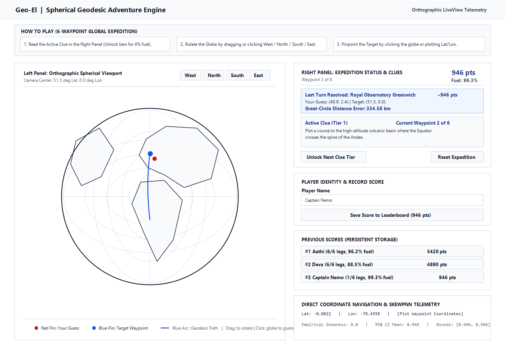

# geo-el

This is a geography game written in Elixir using Phoenix LiveView and Open Telecom Platform (OTP) supervision trees.



## How to Play

### Objective

Each expedition draws a randomized sequence of unique waypoints without replacement (default `6`, configurable via `expedition_size` in `priv/data/questions.yaml`) from the YAML question bank stored in [`priv/data/questions.yaml`](priv/data/questions.yaml). The default catalog includes 24 landmarks spanning all continents and latitude bands (such as `Royal Observatory Greenwich`, `Mitad del Mundo in Quito`, `Mount Kilimanjaro`, `Lake Baikal`, `Uluru Monolith`, `Spitsbergen Fjord in Svalbard`, `Strait of Hormuz`, and `Milford Sound in Fiordland`). Starting a new expedition excludes the previous run's waypoints first so consecutive runs do not repeat questions. For each stage, read the geographic clue, rotate the 3D orthographic globe to locate the target region, and pinpoint the waypoint before your expedition fuel (`100%`) runs out.

### Step-by-Step Gameplay

1. **Read the Active Clue (`Expedition Status` Panel):**
   - Look at the **Active Clue** box on the right side of the screen.
   - Each waypoint has three progressive clue tiers:
     - **Tier 1 (Geomorphological Clue - `1.0x` score multiplier):** Describes tectonic, hydrological, or astronomical characteristics without naming the country.
     - **Tier 2 (Regional Clue - `0.85x` score multiplier):** Identifies the landmass, island, river basin, or sea.
     - **Tier 3 (Coordinate Telemetry - `0.70x` score multiplier):** Provides approximate target latitude and longitude coordinates.
   - If you are stuck, click **Unlock Next Clue Tier** to reveal a more specific clue at the cost of `4%` expedition fuel.

2. **Rotate the Orthographic Globe (`Orthographic Spherical Viewport`):**
   - **Drag with Mouse / Pointer:** Press and drag anywhere on the globe to rotate the visible hemisphere.
   - **Direction Buttons:** Click **West**, **North**, **South**, or **East** above the globe to rotate the camera center in `15` degree latitude or `20` degree longitude increments.
   - The current camera center $(\phi_0, \lambda_0)$ is displayed under the viewport header (`Camera Center: X deg Lat, Y deg Lon`).

3. **Submit Your Waypoint Guess (Choose Either Method):**
   - **Method A - Click Directly on the Globe:** Click once (without dragging) on the spot on the globe where you think the waypoint is located. The server converts your 2D SVG click coordinates $(x, y)$ into spherical latitude and longitude $(\phi, \lambda)$ via inverse orthographic projection.
   - **Method B - Direct Coordinate Navigation:** Type numeric **Latitude (`-90` to `90`)** and **Longitude (`-180` to `180`)** values into the **Direct Coordinate Navigation** form and click **Plot Waypoint Coordinates**.

4. **Review Turn Feedback and Advance:**
   - Submitting a guess immediately scores the current waypoint leg and advances the expedition to the next waypoint:
     - **Red Pin (`#b91c1c`):** Shows the exact coordinates of your guess on the globe.
     - **Blue Pin (`#1d4ed8`):** Shows the true waypoint coordinates, and re-centers the camera on the discovered target.
     - **Blue Geodesic Curve:** Draws the great-circle flight path connecting completed expedition waypoints across the globe.
     - **Last Turn Result & Completed Expedition Legs:** Displays your great-circle Haversine distance error (`Residual: X km`), proficiency score $S_k \in [0, 1]$, and points awarded (`0` to `1000` pts).
     - **Fuel Consumption:** Distance errors burn expedition fuel (`distance_km / 450`, capped at `30%` per leg).
     - **Adaptive Clue Routing (`A2`):** High accuracy ($S_k \ge 0.75$) starts your next waypoint at **Tier 1** for maximum points; larger distance errors automatically start the next waypoint at **Tier 2** or **Tier 3** to assist your navigation.

5. **Record Your Player Name and Score (`Player Identity & Record Score`):**
   - Enter your name in the **Player Name** input field inside the **Player Identity & Record Score** card in the right panel and click **Save Score to Leaderboard**.
   - Your name, score, completed waypoints, remaining fuel, and UTC timestamp are saved persistently to disk (`priv/data/leaderboard.json`) via `GeoEl.Adventure.ScoreStore` and displayed in the **Previous Scores (Persistent Storage)** leaderboard across sessions and server restarts.

6. **Complete or Reset the Expedition:**
   - The expedition ends when all stages are completed or if fuel reaches `0%`. Click **Reset Expedition** (or **Start New Expedition**) at any time to start a fresh run.

## Managing Questions and Answers (`priv/data/questions.yaml`)

All questions (clues) and answers (target landmark names and latitude/longitude coordinates) are loaded dynamically from [`priv/data/questions.yaml`](priv/data/questions.yaml) rather than hardcoded in Elixir source files. A teacher or instructor can add, edit, or remove questions using any plain-text editor (Notepad, TextEdit, VS Code).

### Step-by-Step Guide for Teachers

1. Open `priv/data/questions.yaml`.
2. Add a new entry under the `questions:` list (indent with 2 spaces; do not use Tab characters):

```yaml
questions:
  # Optional setting near the top of the file: number of questions drawn per round
  # expedition_size: 6

  - id: wp-grand-canyon
    name: "Grand Canyon, Arizona"
    region: "Colorado Plateau, North America"
    lat: 36.1069
    lon: -112.1129
    tier1_clue: "Locate the steep-sided river gorge carved across a high arid plateau in southwestern North America."
    tier2_clue: "Formed by the Colorado River in northern Arizona."
    tier3_clue: "Target telemetry: latitude 36.1 degrees North, longitude 112.1 degrees West."
```

3. **Field Reference:**

| Field | Required | Description |
| :--- | :--- | :--- |
| `name` | Yes | Correct answer / landmark name shown in turn feedback and the expedition log (`answer` is also accepted). |
| `lat` | Yes | Target latitude in decimal degrees from `-90.0` (South Pole) to `90.0` (North Pole). Use negative numbers for South. |
| `lon` | Yes | Target longitude in decimal degrees from `-180.0` (West) to `180.0` (East). Use negative numbers for West. |
| `tier1_clue` | Yes | Primary question shown immediately at the start of the turn (`question` is also accepted). |
| `region` | No | Geographic region label. Defaults to `"Global Landmark"` if omitted. |
| `tier2_clue` | No | Hint unlocked for `4%` fuel (`0.85x` points). Auto-generated from `region` if omitted. |
| `tier3_clue` | No | Coordinate hint unlocked for `4%` fuel (`0.70x` points). Auto-generated from `lat` and `lon` if omitted. |
| `id` | No | Unique short identifier such as `wp-grand-canyon`. Auto-generated from `name` if omitted. |

4. **Minimal Entry Example:**
   If you want to add classroom quiz questions quickly, only `name`, `lat`, `lon`, and `tier1_clue` are required:

```yaml
  - name: "Taj Mahal, Agra"
    lat: 27.1751
    lon: 78.0421
    tier1_clue: "Identify the white marble mausoleum standing along the southern bank of the Yamuna River."
```

5. **Applying and Validating Changes:**
   - **Live Auto-Reload:** If the game server is already running, saving `priv/data/questions.yaml` automatically reloads the question bank when any student clicks **Reset Expedition** or opens a new browser session.
   - **Custom Round Length:** Change `expedition_size: 6` at the top of `priv/data/questions.yaml` if you want shorter or longer rounds (automatically capped at the total number of questions in the file).
   - **Formatting Tip:** Wrap clues containing `#` characters in double quotes `"..."`, and always use spaces instead of Tabs for indentation.
   - **Validation Check:** Run `mix test` (or `mix precommit`) after editing to verify YAML syntax, unique IDs, and BISE coordinate bounds (`lat` in `[-90, 90]`, `lon` in `[-180, 180]`).

## Architecture Overview

- **YAML Question Bank & Constant Cache (`GeoEl.Globe.YamlParser` and `GeoEl.Globe.WorldData`):** Parses teacher-editable questions and coordinates from [`priv/data/questions.yaml`](priv/data/questions.yaml), enforces BISE coordinate and ID validation, hot-reloads on file modification, and caches the validated catalog in Erlang `:persistent_term`.

- **Orthographic Spherical Projection (`GeoEl.Globe.Projection` and `GeoEl.Globe.Math`):** Performs server-side forward and inverse orthographic projections between spherical Earth coordinates $(\phi, \lambda)$ and two-dimensional Scalable Vector Graphics (SVG) viewport coordinates $(x, y)$, alongside Haversine great-circle distance and geodesic arc interpolation.
- **Bounded Input State Enforcement (`GeoEl.Adventure.BISE`):** Enforces radial domain clamping ($\hat{u} \in [0.0, 1.0]$) during inverse trigonometric projection, sanitizes viewport rotation deltas and player identity strings, and verifies closed cartographic polygon rings at startup.
- **Adaptive Calibration (`GeoEl.Adventure.Calibration`):** Implements the `SkewPNN` skewed exponential kernel and `A2` adaptive clue routing controller with foreshortening compensation and $95\%$ confidence interval tracking.
- **Supervised Adventure Sessions (`GeoEl.Adventure.SessionServer`):** Isolates each active explorer session inside a supervised `GenServer` worker under a `DynamicSupervisor` (`GeoEl.Adventure.Supervisor`) and broadcasts completed expedition legs over `Phoenix.PubSub`.
- **Persistent Score Storage (`GeoEl.Adventure.ScoreStore`):** Supervised `GenServer` that persists sanitized player names and expedition scores to a JSON store (`priv/data/leaderboard.json`) and broadcasts real-time leaderboard updates over `Phoenix.PubSub`.
- **Interactive Light-Themed Viewport (`GeoElWeb.GlobeLive`):** Renders a high-contrast light-themed two-panel SVG globe interface with pointer drag and coordinate picking hooks.

## Automated Prerequisite and Project Setup

Instead of installing Erlang/OTP, Elixir, Hex, Rebar, and Mix dependencies manually, use the provided bootstrap scripts for Windows or Linux.

### Windows (`setup.bat`)

Run the Windows batch script from Command Prompt or PowerShell:

```powershell
.\setup.bat
```

The `setup.bat` script checks for Erlang/OTP and Elixir, installs missing runtimes via `winget`, persists the `bin` directories to your Windows User `PATH`, configures the PowerShell execution policy, initializes `Hex` and `Rebar`, and executes both `mix setup` and `mix precommit`.

Because `.bat` files execute in a child `cmd.exe` process, an already-open PowerShell window will not reload its in-memory `$env:Path` until you either open a new terminal tab or refresh `$env:Path` in the current PowerShell session:

```powershell
$env:Path = "C:\Program Files\Erlang OTP\bin;C:\Program Files\Elixir\bin;" + $env:Path
mix.bat precommit
mix.bat phx.server
```

### Linux (`setup.sh`)

Run the Linux shell script to install Erlang/OTP, Elixir, and build tools via the system package manager (`apt-get`, `dnf`, `pacman`, `apk`, or `zypper`), initialize `Hex` and `Rebar`, and execute `mix setup`:

```bash
chmod +x setup.sh
./setup.sh
```

## Development and Verification

Once setup is complete, run the verification suite:

```bash
mix precommit
```

To start the Phoenix web endpoint locally (accessible at `http://localhost:4000`):

```bash
mix phx.server
```
